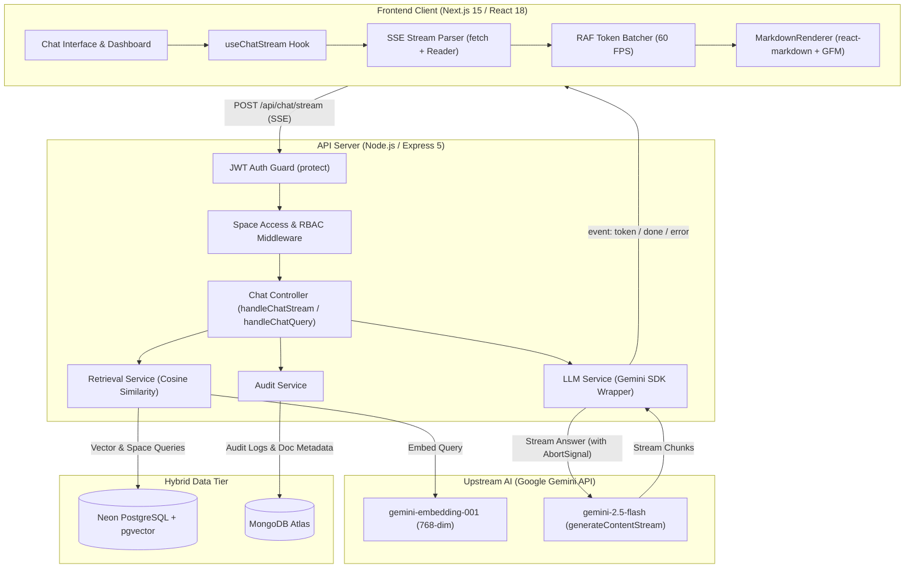
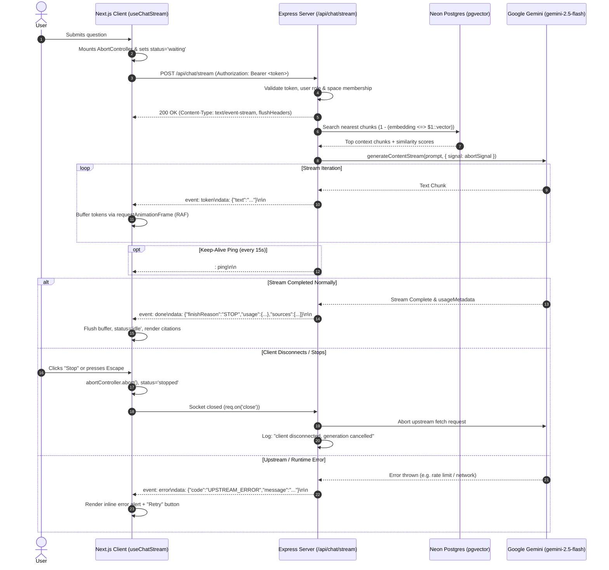

# Enterprise Knowledge Assistant (Cortex)

An enterprise-grade, RAG-based (Retrieval-Augmented Generation) internal document Q&A assistant built with a layered Node.js/Express backend and a modern Next.js 15 frontend. The platform secures proprietary company documentation with strict Role-Based Access Control (RBAC) and departmental Space isolation, featuring a production-ready Server-Sent Events (SSE) streaming engine powered by Google Gemini.

---

## 🏗️ System Architecture



---

## ⚡ Streaming Architecture & Protocol



### Event Specification

Each event is serialized as standard Server-Sent Events (`event: <name>\ndata: <json>\n\n`):

| Event | Payload Structure | Purpose |
|---|---|---|
| `token` | `{"text": "<string>"}` | Delivers an incremental text delta generated by the model. |
| `done` | `{"finishReason": "STOP", "usage": {"promptTokens": N, "completionTokens": N, "totalTokens": N}, "sources": [...]}` | Signals successful completion, returns token counts, and attaches cited document references. |
| `error` | `{"code": "BAD_REQUEST \| FORBIDDEN \| RETRIEVAL_ERROR \| UPSTREAM_ERROR", "message": "<safe user string>"}` | Emits safe, user-friendly failure details without leaking stack traces or internal API credentials. |
| `: ping` | *(SSE Comment)* | Dispatched every 15 seconds to prevent intermediate reverse proxies (Nginx, Cloudflare) from closing idle connections. |

### Streaming Engine Features

* **Non-Blocking Fetch Stream Reader:** Implemented via `fetch` + `response.body.getReader()` and `new TextDecoder('utf-8')` with `{ stream: true }`.
* **Zero Re-Render Storms:** High-frequency token streams are buffered in memory and batched to the UI via `requestAnimationFrame` (~16–33ms), delivering smooth 60 FPS rendering without CPU saturation.
* **Mid-Stream Fault Tolerance:** Markdown rendering tolerates unclosed code fences (````), partial lists, and incomplete tables without jumping or layout shift.
* **Full Cancellation Lifecycle:** A dedicated `AbortController` is attached to every stream. Clicking "Stop" or hitting `Escape` aborts the upstream Gemini call, stops iteration, preserves partial output on screen, and releases stream locks cleanly.
* **Auto-Scroll with Manual Override:** Automatically follows generation down, but disengages if the user scrolls up to inspect previous answers, showing a "Jump to latest" floating pill.

---

## 🛠️ Technology Stack

### Backend
* **Runtime & Framework:** Node.js, Express.js (v5.2.1)
* **Relational Database & Vector Store:** PostgreSQL (Neon Serverless) with the `pgvector` extension (768-dimensional document and query embeddings)
* **Document Metadata & Audit Logs:** MongoDB Atlas via Mongoose (v9.7.3)
* **AI & LLM Services:**
  * Embedding Model: Google Gemini `gemini-embedding-001` (768 dimensions)
  * Chat Generation: Google Gemini `gemini-2.5-flash` (`generateContentStream` & `generateContent`)
* **Document Ingestion:** Multer (memory storage, 20MB limit), `pdf-parse`, `mammoth` (DOCX extraction), semantic sliding-window text chunker (1000 characters, 150 overlap)
* **Authentication & Security:** JWT (`jsonwebtoken`), password hashing (`bcrypt`), RBAC & Space access middleware

### Frontend
* **Core:** Next.js 15 (v15.5.20) App Router, React 18, TypeScript 5
* **State Management:** Zustand (v4.5.4) for auth state & session storage
* **Styling & Icons:** Tailwind CSS (v3.4.1), Lucide React
* **Animations & Modals:** Framer Motion (v12.42.2)
* **Markdown & Syntax Highlighting:** `react-markdown` (v10), `remark-gfm` (v4), `rehype-highlight` (v7) with GitHub Dark theme
* **Feedback & Metrics:** Sonner (toasts), Recharts (dashboard analytics)
* **HTTP Client:** Axios (v1.7.2) for standard management endpoints; native `fetch` for SSE streams

---

## ✨ Features

* **3-Tier Role-Based Access Control (RBAC):**
  * `Admin`: Full system control, space creation, user assignment, global document oversight, audit logs, and analytics.
  * `Editor`: Document upload, metadata modification, and deletion restricted exclusively to assigned spaces.
  * `Viewer`: Read-only document access and RAG Q&A chat restricted exclusively to assigned spaces.
* **Departmental Space Isolation:** Multi-tenant workspace scoping where users can only search, retrieve, or query document chunks indexed within spaces they belong to.
* **Dual Chat Engine:** Real-time token streaming (SSE) with an instant toggle to standard synchronous REST mode for verification and fallback testing.
* **Rich Markdown Support:** Assistant outputs render headers, tables, task lists, and syntax-highlighted code blocks with an integrated one-click "Copy" button.
* **Accessibility (a11y):** Screen-reader polite announcements (`aria-live="polite"`), explicit ARIA attributes, keyboard navigation (`Enter` to send, `Escape` to stop), and `prefers-reduced-motion` compliance.
* **Audit Logging & Analytics:** Automatic tracking of logins, role updates, uploads, deletions, and chat queries with administrative filtering by user, date, or action.

---

## 📂 Project Directory Structure

```
enterprise-knowledge-assistant/
├── backend/
│   ├── src/
│   │   ├── config/             # Database & AI initializations (Neon, Mongo, Gemini)
│   │   ├── controllers/        # Request handlers (auth, space, user, doc, audit, chat)
│   │   ├── middleware/         # JWT protect, role authorization, space access guard
│   │   ├── models/
│   │   │   ├── mongo/          # Document & AuditLog schemas
│   │   │   └── postgres/       # User, Space, UserSpace, DocumentChunk models
│   │   ├── routes/             # Express routes (including /api/chat and /api/chat/stream)
│   │   ├── services/           # Ingestion, vector retrieval, LLM Gemini services
│   │   ├── utils/              # Text extraction, chunking, API responses
│   │   ├── app.js              # Express app definition & CORS configuration
│   │   └── server.js           # Server bootstrap & DB connection test
│   ├── .env.example            # Backend environment template
│   ├── seed.js                 # Seeder for Admin, Editor, Viewer accounts & default Space
│   └── test_stream.js          # Automated verification test suite for SSE streaming
│
├── frontend/
│   ├── app/
│   │   ├── (auth)/             # Login & register pages
│   │   ├── (dashboard)/        # Layout-wrapped authenticated dashboard routes
│   │   │   ├── admin/          # Admin CRUD (Users, Spaces, Audit Logs)
│   │   │   ├── dashboard/      # Overview metrics & Recharts visualization
│   │   │   ├── documents/      # Document upload, metadata edit, delete, reprocess
│   │   │   └── chat/           # Interactive streaming chat interface
│   │   ├── globals.css         # Styling, tokens, and highlight.js theme
│   │   └── layout.tsx          # Root HTML layout with Sonner toast provider
│   ├── components/
│   │   ├── chat/               # MessageBubble, ChatInput, MarkdownRenderer, TypingIndicator
│   │   └── FloatingChatWidget.tsx # Global slide-over chat widget with @mentions
│   ├── hooks/
│   │   └── useChatStream.ts    # Custom SSE streaming hook (fetch, reader, RAF batcher)
│   ├── lib/                    # Axios client, auth storage, Zustand store
│   ├── types/                  # Shared TypeScript interfaces
│   └── .env.example            # Frontend environment template
```

---

## ⚙️ Setup & Installation

### Prerequisites
* [Node.js](https://nodejs.org/) (v18.x or higher)
* [PostgreSQL](https://neon.tech/) instance with the `pgvector` extension enabled
* [MongoDB](https://www.mongodb.com/atlas) cluster (Atlas recommended)
* [Google Gemini API Key](https://aistudio.google.com/)

---

### 1. Backend Configuration

Navigate to `backend/` and create your `.env` file:

```bash
cd backend
cp .env.example .env
```

Edit `backend/.env`:
```env
PORT=5000
MONGO_URI=mongodb+srv://<username>:<password>@cluster0.example.mongodb.net/knowledge_assistant?retryWrites=true&w=majority
PG_CONNECTION_STRING=postgresql://<user>:<password>@<neon-host>/<database>?sslmode=verify-full
JWT_SECRET=your_super_secret_jwt_random_string_here
GEMINI_API_KEY=AIzaSyYourGeminiApiKeyHere
```

Install backend dependencies:
```bash
npm install
```

Seed the default roles and workspace:
```bash
# Seed accounts without modifying existing records
node seed.js

# OR perform a clean reset of test records and re-seed:
node seed.js --clean
```

Default credentials created:
* 🛡️ **Admin:** `admin@company.com` / `Admin@1234`
* ✏️ **Editor:** `editor@company.com` / `Editor@1234` (assigned to "General Knowledge")
* 👁️ **Viewer:** `viewer@company.com` / `Viewer@1234` (assigned to "General Knowledge")

Start the backend server:
```bash
npm run dev
# Server starts on http://localhost:5000
```

---

### 2. Frontend Configuration

In a separate terminal, navigate to `frontend/`:

```bash
cd frontend
cp .env.example .env.local
```

Edit `frontend/.env.local`:
```env
NEXT_PUBLIC_API_URL=http://localhost:5000/api
```

Install frontend dependencies:
```bash
npm install
```

Start the Next.js development server:
```bash
npm run dev
# Dashboard opens on http://localhost:3000
```

---

## 🧪 Testing the Streaming Endpoint

You can test the SSE endpoint directly from the command line using `curl`:

```bash
# 1. Authenticate and retrieve token
TOKEN=$(curl -s -X POST http://localhost:5000/api/auth/login \
  -H "Content-Type: application/json" \
  -d '{"email":"admin@company.com","password":"Admin@1234","role":"admin"}' \
  | grep -o '"token":"[^"]*' | cut -d'"' -f4)

# 2. Open an unbuffered SSE stream
curl -N -X POST http://localhost:5000/api/chat/stream \
  -H "Authorization: Bearer $TOKEN" \
  -H "Content-Type: application/json" \
  -d '{"question":"What documentation is available in our space?"}'
```

To run the automated backend test suite covering aborts, disconnects, bad inputs, and upstream errors:
```bash
cd backend
node test_stream.js
```

---

## ⚠️ Known Limitations & Roadmap

In adherence to engineering integrity, the following items represent current constraints and scheduled roadmap items:

1. **Single-Turn Context Window (Current):** The LLM prompt currently grounds answers using retrieved vector chunks for the immediate query. Previous conversation turns are not yet threaded into multi-turn chat memory.
2. **In-Memory File Processing:** Uploaded files are ingested via in-memory buffers (`multer.memoryStorage()`) to extract text and generate chunks. Original binary files (PDF/DOCX) are not retained in cloud object storage (S3/GCS); only text chunks and vectors are persisted in PostgreSQL.
3. **Cache Layer:** Vector embeddings and queries are generated on-demand without Redis caching. High-frequency queries would benefit from a Redis response cache.
4. **Chat Session Persistence:** While MongoDB audit records track queries, chat transcripts in the web UI are held in client state and reset on page reload (`ChatSession.model.js` is reserved for future persistent session storage).
5. **Agentic Tool Calling:** Retrieval currently occurs deterministically before calling Gemini; multi-step autonomous tool execution (e.g. LangChain agent loops) is planned for a subsequent version.
