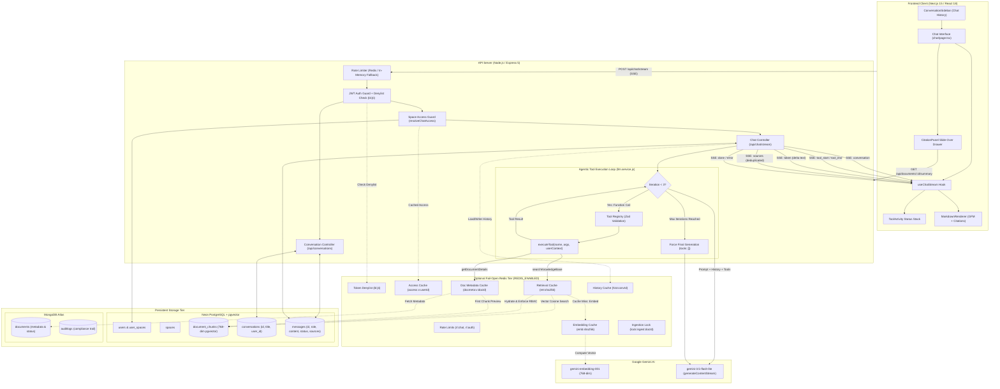

# Enterprise Knowledge Assistant (Cortex)

An enterprise-grade, RAG-based (Retrieval-Augmented Generation) internal document knowledge assistant built with a layered **Node.js/Express** backend and a modern **Next.js 15** frontend. The platform secures proprietary company documentation with strict **Role-Based Access Control (RBAC)** and departmental **Space isolation**, featuring an **Agentic Tool Calling** loop powered by the **Google Gemini SDK**, real-time **Server-Sent Events (SSE)** streaming, **PostgreSQL chat persistence**, and an **optional fail-open Redis performance & security layer**.

---

## 🏗️ System Architecture

The following diagram illustrates the complete end-to-end data flow: from client query submission, through Express authentication, rate limiting, and token denylist verification, down to the bounded agentic tool loop, optional Redis caches, PostgreSQL vector retrieval (`pgvector`), MongoDB metadata, upstream Gemini generation, and real-time SSE streaming.



---

## ⚡ Streaming Architecture & Protocol

Cortex delivers a production-grade Server-Sent Events (SSE) streaming engine adhering to HTTP/1.1 event-stream standards (`Content-Type: text/event-stream`, `Cache-Control: no-cache`, `Connection: keep-alive`, `X-Accel-Buffering: no`).

```mermaid
sequenceDiagram
    autonumber
    actor User
    participant Client as Next.js Client (useChatStream)
    participant Server as Express Server (/api/chat/stream)
    participant Loop as Tool Loop (llm.service)
    participant Redis as Redis (Fail-Open)
    participant PG as PostgreSQL (pgvector & persistence)
    participant Gemini as Google Gemini SDK

    User->>Client: Submits prompt
    Client->>Client: Mount AbortController & set status='waiting'
    Client->>Server: POST /api/chat/stream (Bearer JWT, question, spaceId, conversationId?)
    Server->>Redis: Check token denylist (bl:<jti>) & Rate limit
    Server->>Server: Validate token signature & resolve space permissions
    Server->>PG: Ensure / create conversation & save user message
    Server-->>Client: HTTP 200 (flushHeaders: text/event-stream)
    Server-->>Client: event: conversation\ndata: {"id":"...","title":"..."}\n\n

    Server->>Loop: runAgentStream({ question, userContext, history })
    Loop->>Gemini: generateContentStream({ contents, tools })

    opt Tool Execution Turn (Iteration 0..2)
        Gemini-->>Loop: functionCall: searchKnowledgeBase(query, topK)
        Loop-->>Server: onToolStart event
        Server-->>Client: event: tool_start\ndata: {"id":"...","name":"searchKnowledgeBase",...}\n\n
        Loop->>Redis: Check retrieval cache (ret:<hash>)
        alt Cache Miss
            Loop->>Redis: Check embedding cache (emb:<hash>)
            alt Embedding Miss
                Loop->>Gemini: embedContent (gemini-embedding-001)
                Gemini-->>Loop: 768-dim vector
                Loop->>Redis: Cache vector (TTL 24h)
            end
            Loop->>PG: Vector cosine search filtered by user space_id
            PG-->>Loop: Ranked candidate chunks
            Loop->>Redis: Cache ranked candidates [{chunkId, score}] (TTL 300s)
        end
        Loop->>PG: Hydrate chunks & re-verify space permissions
        PG-->>Loop: Hydrated chunks + snippets
        Loop-->>Server: onToolEnd event
        Server-->>Client: event: tool_end\ndata: {"id":"...","name":"searchKnowledgeBase","ok":true,...}\n\n
        Loop->>Gemini: Feed functionResponse back into conversation turn
    end

    loop Text Generation Stream
        Gemini-->>Loop: Text delta chunk
        Loop-->>Server: onToken event
        Server-->>Client: event: token\ndata: {"text":"..."}\n\n
        Client->>Client: Buffer tokens & batch update via requestAnimationFrame
    end

    opt Keep-Alive Heartbeat (every 15s)
        Server-->>Client: : ping\n\n
    end

    Server-->>Client: event: sources\ndata: [{"documentId":"...","title":"...","score":0.52}]\n\n
    Server->>PG: Persist assistant message (role: 'assistant', status: 'complete', sources, tool_activity)
    Server->>Redis: Update recent history cache (hist:<conversationId>)
    Server-->>Client: event: done\ndata: {"finishReason":"STOP","usage":{...}}\n\n
    Client->>Client: Flush buffer, status='idle', render citation buttons

    opt Client Abort / Disconnect Mid-Stream
        User->>Client: Clicks "Stop" or hits Escape
        Client->>Client: abortController.abort(), status='stopped'
        Client->>Server: TCP disconnect / socket close (req.on('close'))
        Server->>Gemini: Abort upstream stream
        Server->>PG: Persist assistant message with status='stopped'
        Server->>Server: Log: "client disconnected, generation cancelled"
    end
```

### SSE Event Specification

Every payload is serialized strictly as `event: <name>\ndata: <json>\n\n`:

| Event | Payload Fields | Purpose |
|---|---|---|
| `conversation` | `{"id": string, "title": string}` | Emitted immediately upon connection to notify the client of the active or newly created conversation ID and auto-generated title for sidebar synchronization. |
| `tool_start` | `{"id": string, "name": string, "argsSummary": string}` | Emitted immediately when Gemini requests a tool, signaling the frontend to display an active tool progress pill with animated spinner. |
| `tool_end` | `{"id": string, "name": string, "durationMs": number, "resultCount": number, "ok": boolean}` | Dispatched when tool execution completes, reporting latency, items retrieved, and success status. |
| `token` | `{"text": string}` | Incremental generated markdown text delta streamed from Gemini. |
| `sources` | `[{"documentId": string, "title": string, "pageNumber": number \| null, "score": number}]` | Deduplicated array of cited document references feeding the interactive citation chips and drawer. |
| `done` | `{"finishReason": "STOP" \| "MAX_TOKENS", "usage": {"promptTokens": N, "completionTokens": N, "totalTokens": N}}` | Signals stream completion with token usage metadata. |
| `error` | `{"code": "BAD_REQUEST" \| "FORBIDDEN" \| "UPSTREAM_ERROR", "message": string}` | Emits safe, sanitized failure descriptions without leaking stack traces or internal environment secrets. |
| `: ping` | *(SSE Comment)* | Dispatched every 15 seconds to prevent reverse proxies (Nginx, Cloudflare) from terminating idle connections. |

---

## 🤖 Agentic Tool-Calling Design & Architecture

Cortex implements a secure, bounded agentic tool-calling engine built directly on the **Google Gemini SDK** with **Zod** schema validation. The LLM autonomously determines whether to call retrieval tools or answer directly based on context.

### 1. Tool Definitions & Capabilities

The tool registry (`backend/src/tools/index.js`) declares two production tools:

1. **`searchKnowledgeBase`**:
   * **Schema:** `{ query: string (min 2 chars), topK?: number (1-8, default 5) }`
   * **Behavior:** Generates a 768-dimensional embedding of the query using `gemini-embedding-001`, searches PostgreSQL `document_chunks` via cosine similarity (`1 - (embedding <=> $1::vector)`), restricted to the user's accessible spaces.
   * **Output:** Returns `{ query, excerpts: [{ documentId, title, pageNumber, snippet, score }], count }`.
2. **`getDocumentDetails`**:
   * **Schema:** `{ documentId: string (valid ObjectId) }`
   * **Behavior:** Retrieves comprehensive document metadata, workspace space name, chunk count, upload timestamp, and first chunk preview from MongoDB and PostgreSQL.
   * **Output:** Returns `{ documentId, title, originalName, spaceId, spaceName, mimeType, status, chunkCount, createdAt, previewSnippet }`.

### 2. Strict Zod Argument Validation & Self-Correction

Model-generated function arguments are never executed raw. They pass through strict Zod schemas:
* **Validation Failure:** If Gemini produces invalid arguments (e.g. query $< 2$ characters, invalid ID), the engine catches the `ZodError` and returns a structured error object back to the model turn (`{ error: 'VALIDATION_ERROR', message: '...' }`).
* **Resilience:** The application never crashes on bad model output; the structured error allows Gemini to self-correct its parameters in the subsequent turn.

### 3. Bounded Execution Loop (Max 3 Iterations)

To eliminate infinite tool loops and control token expenditure, `runAgentStream` enforces a strict iteration guard:
* **Iteration Counter:** A turn counter tracks every function-call iteration.
* **Forced Termination Cap:** If the iteration count reaches `MAX_TOOL_ITERATIONS = 3`, Cortex forcefully strips tools from the model configuration (`tools: []`) and prompts Gemini for a final grounded synthesis turn.

### 4. Authenticated Server-Side Context & RBAC Isolation

Security is enforced at the server boundary:
* **Zero Model Control over Identity:** The model NEVER passes `userId`, `spaceId`, or authorization flags. All user identity and authorized space IDs (`targetSpaceIds`) are derived server-side from `req.user` via `resolveChatAccess`.
* **Zero-Leak Document Verification:** If a user requests details for a document located in a space they cannot access, the tool returns a generic `"Document not found or access denied"` status (HTTP 404), ensuring unauthorized documents remain completely invisible.

### 5. Fallback Flag (`USE_TOOL_CALLING`)

The platform supports zero-downtime regression fallback:
* **`USE_TOOL_CALLING=true` (Default):** Runs the multi-turn agentic loop where Gemini decides when to search.
* **`USE_TOOL_CALLING=false`:** Falls back to static RAG (deterministic vector search in the controller before streaming).

---

## ⚡ Caching and Consistency

Cortex features an enterprise **fail-open Redis layer** designed for high throughput, sub-millisecond memoization, and strict cross-user data isolation. If Redis is disabled (`REDIS_ENABLED=false`) or encounters downtime, every operation seamlessly and transparently falls back to PostgreSQL and MongoDB.

### Cache Matrix & Invalidation Strategy

| Component | Redis Key Pattern | Default TTL | Invalidation Trigger | Fail-Open Strategy |
|---|---|---|---|---|
| **Token Denylist** | `cortex:bl:<jti>` | Remaining token lifespan (`exp - now`) | Natural expiration; set upon `POST /api/auth/logout` | Configurable: `AUTH_DENYLIST_FAIL_CLOSED=false` permits login; `true` rejects with 401 |
| **Rate Limiter** | `cortex:rl:<type>:<id>` | Window seconds (60s chat, 900s auth, 3600s upload) | Sliding window reset | Falls back to in-process memory map |
| **Query Embedding** | `cortex:emb:<sha256(model:dim:normQuery)>` | 86,400s (24h) | Immutable per model version | Calls Gemini `embedContent` API directly |
| **User Space Access** | `cortex:access:v<version>:<userId>` | 120s | Role change, space assignment, user deactivation, or global `access:version` bump | Re-queries PostgreSQL `users` & `user_spaces` |
| **Document Metadata** | `cortex:docmeta:v<version>:<docId>` | 300s (5m) | Document update, deletion, or space reassignment | Re-queries MongoDB `Document` collection |
| **Retrieval Results** | `cortex:ret:<sha256(v:model:normQuery:topK:spaceIds)>` | 300s (5m) | Any doc create, update, delete, re-ingest, or space deletion bumps `corpus:version` | Executes live vector query on PostgreSQL `pgvector` |
| **Recent Model History** | `cortex:hist:<conversationId>` | 3,600s (1h) | Refreshed on assistant message completion; deleted on conversation removal | Cheap DB primary key ownership check, then queries PostgreSQL `messages` |
| **Ingestion Lock** | `cortex:lock:ingest:<docId>` | 60s | Released upon ingestion complete/failure; auto-expires if process crashes | Skips distributed lock, processes sequentially |

### 🔒 Zero Data Leak Guarantee in Retrieval Caching

Unlike naive RAG systems that cache rendered chunk text or answers, Cortex enforces two non-negotiable security invariants in `retrievalCache.service.js`:

1. **Only Ranked IDs are Cached:** The Redis retrieval cache stores ONLY an array of candidate references: `[{ chunkId: number, score: number }]`. It **NEVER** stores chunk content, document text, or metadata in Redis.
2. **Access Filter Re-Applied During PostgreSQL Hydration:** When a retrieval cache HIT occurs, the candidate chunk IDs are re-hydrated from PostgreSQL using:
   ```sql
   SELECT id, document_id, space_id, content, page_number
   FROM document_chunks
   WHERE id = ANY($1::bigint[])
     AND space_id = ANY($2::int[])
   ```
   Because `$2` contains the *current* authenticated user's authorized spaces (resolved fresh on each request), even if a key collision or stale key occurred, chunks belonging to spaces the user cannot access are physically filtered out by PostgreSQL.

### 🔄 The Global Atomic `corpus:version` Counter

To eliminate stale retrieval results across all users when documentation changes, Cortex tracks a global atomic counter in Redis: `cortex:corpus:version`.
* **Atomic Invalidation:** Whenever a document is uploaded, updated, deleted, re-ingested, or a space is deleted, Cortex calls `incrementCorpusVersion()`.
* **Zero Overhead:** This single Redis `INCR` call instantly invalidates all existing retrieval cache keys across the entire system in $O(1)$ time, eliminating the need to scan or purge millions of keys.

### 🛡️ Fail-Open Architecture & Resilience

All Redis interactions operate through `cache.service.js` and `redis.client.js`:
* **Short Command Timeout:** Redis commands timeout after 150ms to ensure database queries are never held up by a lagging cache.
* **`enableOfflineQueue: false`:** Commands fail immediately when disconnected rather than queuing up unbounded memory.
* **Rate-Limited Logging:** Connection errors are logged once per throttle window to prevent console log flooding.
* **100% Graceful Fallback:** Every cache get operation returns `null` (cache miss) on any Redis error, allowing the application to function identically to an uncached deployment.

### 🔑 Token Denylist & Security Trade-Off (`AUTH_DENYLIST_FAIL_CLOSED`)

When a user logs out (`POST /api/auth/logout`), Cortex extracts the unique UUID `jti` claim from their JWT and records it in Redis under `cortex:bl:<jti>` with a TTL matching the token's remaining validity.

* **Fail-Open Default (`AUTH_DENYLIST_FAIL_CLOSED=false`):** If Redis becomes unreachable, authentication checks continue using standard cryptographic signature and expiry validation, logging a clear warning. The trade-off is that a token revoked during an outage could still be accepted until its JWT `exp` timestamp elapses.
* **Fail-Closed Mode (`AUTH_DENYLIST_FAIL_CLOSED=true`):** If Redis is unreachable, token revocation cannot be verified, so authenticated requests are rejected with HTTP 401. This guarantees that no revoked token is ever accepted, at the cost of tying auth availability to Redis uptime.

---

## 🛠️ Technology Stack

### Backend
* **Runtime & Framework:** Node.js (v18+), Express.js (v5.2.1)
* **Relational Database & Vector Store:** PostgreSQL (Neon Serverless) with `pgvector` (768-dimensional embeddings)
* **Document Metadata & Compliance Audits:** MongoDB Atlas via Mongoose (v9.7.3)
* **High-Speed Cache Tier:** Redis 7 (via `ioredis` v6.0.0, optional & fail-open)
* **AI & LLM Services:**
  * Embedding Model: Google Gemini `gemini-embedding-001` (768 dimensions)
  * Chat Generation & Agent Loop: Google Gemini `gemini-3.5-flash-lite` (supports function declarations and stream iteration)
* **Schema Validation:** Zod (v3.25.7) for tool declarations and argument verification
* **Document Ingestion:** Multer (memory storage, 20MB limit), `pdf-parse`, `mammoth` (DOCX extraction), sliding-window text chunker (1000 characters, 150 overlap)
* **Authentication & Authorization:** JWT (`jsonwebtoken`) with `jti`, password hashing (`bcrypt`), space-based RBAC middleware

### Frontend
* **Framework:** Next.js 15 (v15.5.20) App Router, React 18, TypeScript 5
* **State Management:** Zustand (v4.5.4) for auth state; custom React refs & hooks for stream batching
* **Styling & Components:** Tailwind CSS (v3.4.1), Lucide React
* **Animations:** Framer Motion (v12.42.2)
* **Markdown & Syntax Highlighting:** `react-markdown` (v10), `remark-gfm` (v4), `rehype-highlight` (v7) with GitHub Dark theme
* **Feedback & Visuals:** Sonner (toasts), Recharts (dashboard visualizer)
* **HTTP & Streaming:** Native `fetch` with `ReadableStreamDefaultReader` for SSE; Axios (v1.7.2) for management endpoints

---

## 🎛️ Feature Flags Reference

| Flag Name | Allowed Values | Default | Purpose |
|---|---|---|---|
| `USE_TOOL_CALLING` | `true` \| `false` | `true` | When `true`, runs the multi-turn agentic Gemini tool loop. When `false`, falls back to deterministic static RAG retrieval in the controller. |
| `REDIS_ENABLED` | `true` \| `false` | `false` | Master switch for the Redis tier (embedding cache, access cache, metadata cache, denylist, locks, and rate limiting). When `false`, all Redis helpers operate as transparent no-ops. |
| `REDIS_RETRIEVAL_CACHE` | `true` \| `false` | `false` | When `true` (and `REDIS_ENABLED=true`), caches ranked vector retrieval candidates `{ chunkId, score }` keyed by query, space IDs, and corpus version. |
| `REDIS_HISTORY_CACHE` | `true` \| `false` | `false` | When `true` (and `REDIS_ENABLED=true`), caches the recent N complete conversation messages used as model context. Always verified against DB ownership. |
| `AUTH_DENYLIST_FAIL_CLOSED` | `true` \| `false` | `false` | When `false`, permits authentication if Redis is down (fail-open). When `true`, rejects authenticated requests with 401 during Redis outages (fail-closed). |

---

## ⚙️ Setup & Installation

### Prerequisites
* [Node.js](https://nodejs.org/) (v18.x or higher)
* [PostgreSQL](https://neon.tech/) instance with the `pgvector` extension enabled
* [MongoDB Atlas](https://www.mongodb.com/atlas) cluster
* [Google Gemini API Key](https://aistudio.google.com/)
* [Docker & Docker Compose](https://www.docker.com/) (Optional: for running local Redis)

---

### 1. Launch Redis via Docker Compose (Optional)

To enable the optional Redis caching and denylist tier:

```bash
# Start local Redis with healthcheck in the background:
docker-compose up -d redis

# Verify container is healthy:
docker-compose ps
```

---

### 2. Backend Configuration

Navigate to `backend/` and configure your environment:

```bash
cd backend
cp .env.example .env
```

Complete `.env` configuration:
```env
# Server Port
PORT=5000

# MongoDB Atlas Connection URI (stores Document metadata and AuditLogs)
MONGO_URI=mongodb+srv://<username>:<password>@cluster0.example.mongodb.net/knowledge_assistant?retryWrites=true&w=majority

# Neon PostgreSQL with pgvector extension (stores Users, Spaces, user_spaces, document_chunks, conversations, messages)
PG_CONNECTION_STRING=postgresql://<user>:<password>@<neon-host>/<database>?sslmode=verify-full

# JWT Secret for signing authentication tokens
JWT_SECRET=your_super_secret_jwt_random_string_here

# Google Gemini API Key (used for gemini-embedding-001 and gemini-3.5-flash-lite)
GEMINI_API_KEY=AIzaSyYourGeminiApiKeyHere

# Gemini Model Selection (defaults to gemini-3.5-flash-lite)
GEMINI_MODEL=gemini-3.5-flash-lite

# Agentic Tool Calling Feature Flag (default: true; set to false for static RAG fallback)
USE_TOOL_CALLING=true

# Redis Configuration (Optional Foundation, default: false)
REDIS_ENABLED=false
REDIS_URL=redis://127.0.0.1:6379
REDIS_KEY_PREFIX=cortex:
REDIS_RETRIEVAL_CACHE=false
REDIS_HISTORY_CACHE=false
AUTH_DENYLIST_FAIL_CLOSED=false

# Rate Limiting Configuration
RATE_LIMIT_CHAT=20
RATE_LIMIT_CHAT_WINDOW_SEC=60
RATE_LIMIT_AUTH=10
RATE_LIMIT_AUTH_WINDOW_SEC=900
RATE_LIMIT_UPLOAD=10
RATE_LIMIT_UPLOAD_WINDOW_SEC=3600
```

Install backend dependencies:
```bash
npm install
```

Run PostgreSQL migrations (creates `conversations`, `messages`, and ensures `pgvector` tables):
```bash
npm run migrate
```

Seed demo users, spaces, sample documents, and pgvector embeddings:
```bash
node seed.js

# Optional: clean existing demo records and re-seed from scratch:
node seed.js --clean
```

Start backend development server:
```bash
npm run dev
# Server listening on http://localhost:5000
```

---

### 3. Frontend Configuration

In a separate terminal, navigate to `frontend/`:

```bash
cd frontend
cp .env.example .env.local
```

Edit `frontend/.env.local`:
```env
NEXT_PUBLIC_API_URL=http://localhost:5000/api
```

Install frontend dependencies & launch development server:
```bash
npm install
npm run dev
# Application accessible at http://localhost:3000
```

---

## 🎭 Demo Environment & Test Credentials

The database seed script (`backend/seed.js`) automatically provisions a complete enterprise demo environment:

### 👤 Test Accounts
* 🛡️ **Admin:** `admin@company.com` / `admin@1234`
  * Role: `admin`
  * Access: Full access across **ALL** spaces (Engineering & Architecture + Executive & Confidential).
* 👁️ **Viewer:** `viewer@company.com` / `viewer@1234`
  * Role: `viewer`
  * Access: Restricted strictly to **"Engineering & Architecture"**. Cannot view or retrieve documents from "Executive & Confidential".

### 🏢 Workspaces (Spaces)
1. **"Engineering & Architecture":** Public departmental workspace containing technical guides on PostgreSQL pooling, pgvector cosine search, and Redis fail-open architecture.
2. **"Executive & Confidential":** Restricted leadership workspace containing executive bonuses, compensation bands, and Q4 revenue allocation.

### 💬 6 Demo Questions to Showcase Full Capabilities

| # | Scenario | Query Prompt | Expected System Behavior |
|---|---|---|---|
| **1** | **Agentic Tool Call + Citations** | *"How does Cortex handle database connection pooling and sharding?"* | Model autonomously triggers `searchKnowledgeBase`, UI displays animated `ToolActivity` pills with duration, and streams a grounded response with clickable citation chips opening the `CitationPanel`. |
| **2** | **Direct Greeting (Zero Tools)** | *"Hello! Who are you and what spaces can you search?"* | Gemini recognizes conversational intent, bypasses all retrieval tools, and streams an immediate greeting response. |
| **3** | **RBAC Access Isolation** | *"What are the executive bonuses and compensation percentages for Q4?"* | **As Viewer:** Returns 0 chunks / polite refusal (confidential space blocked).<br>**As Admin:** Retrieves from Executive Compensation doc and provides grounded figures with citations. |
| **4** | **Stop Generation Mid-Stream** | *"Explain in extreme detail the full deployment guide and Redis fail-open design."* | User clicks "Stop" (or hits Escape). SSE stream aborts immediately, upstream generation cancels, and partial response is persisted with status `'stopped'`. |
| **5** | **Error Handling & Retry** | Malformed input or simulated upstream disconnection | Frontend catches error event, renders accessible inline error message, and displays a prominent "Retry" button. |
| **6** | **Multi-Turn Chat Persistence & Cache** | *"Can you summarize the second point you just made?"* | Demonstrates conversation continuity: user and assistant turns persist in PostgreSQL, load into the sidebar, and hit the Redis history cache (`hist:<convId>`). |

---

## 🧪 Testing & Verification

Cortex includes an exhaustive automated test suite covering tool schemas, Zod validation, RBAC boundaries, SSE event ordering, Redis fail-open behavior, cache invalidation, and secure token denylist:

```bash
cd backend
npm test
```

### Automated Test Suites (261 Passed, 0 Failed):
1. **`test_agent_tools.js` (68 tests):** Tool registry, Zod validation, RBAC on document details, SSE event order (`conversation -> tool_start -> tool_end -> token -> sources -> done`), greeting flow (zero tools), client abort/stop, static RAG fallback (`USE_TOOL_CALLING=false`), and database persistence of conversations and messages.
2. **`test_redis_features.js` (47 tests):** Fail-open Redis client, command timeouts, query embedding memoization, distributed ingestion locks (`lock:ingest:<docId>`), and multi-tier rate limiting with in-memory fallback.
3. **`test_access_docmeta_cache.js` (28 tests):** `resolveChatAccess` cache with per-user invalidation, global `access:version` counter invalidation on role changes and space deletions, and document metadata caching with strict ownership checks.
4. **`test_retrieval_cache.js` (51 tests):** Retrieval candidate caching (`{ chunkId, score }`), PostgreSQL chunk hydration with space re-filtering, and automatic invalidation on document create/update/delete/move and space deletion via `corpus:version`.
5. **`test_history_cache.js` (33 tests):** Model context history caching, database primary key ownership verification, write-through on assistant completion, status filtering (`complete` only), and character capping parity between DB and cache paths.
6. **`test_token_denylist.js` (34 tests):** Unique JWT `jti` issuance, logout route (`POST /api/auth/logout`), denylist verification in `auth.middleware.js`, legacy token compatibility, remaining TTL auto-expiration, `AUTH_DENYLIST_FAIL_CLOSED` fail-open vs fail-closed verification, and frontend 401 redirect safety.

### Live Command-Line Streaming Test (`curl -N`)

To stream directly from the running API server via command line:

```bash
# 1. Authenticate to obtain a valid JWT token
TOKEN=$(curl -s -X POST http://localhost:5000/api/auth/login \
  -H "Content-Type: application/json" \
  -d '{"email":"admin@company.com","password":"admin@1234","role":"admin"}' \
  | grep -o '"token":"[^"]*' | cut -d'"' -f4)

# 2. Test Live Agentic Tool Calling & Streaming
curl -N -X POST http://localhost:5000/api/chat/stream \
  -H "Authorization: Bearer $TOKEN" \
  -H "Content-Type: application/json" \
  -d '{"question":"How does Cortex handle database connection pooling and sharding?"}'
```

---

## 🎨 Theming System & Design Tokens

Cortex features a semantic design token system built on modern Hallmark design principles with first-class support for both Light and Dark modes.

### 1. Semantic Design Tokens (`frontend/app/tokens.css`)
All styling is driven entirely by CSS custom properties with zero hardcoded palette classes or raw hex codes in components:
- **Base Surfaces:** `--bg`, `--sidebar`, `--surface-1`, `--surface-2`, `--surface-3`, `--surface-code`, `--surface-overlay`
- **Borders:** `--border` (subtle hairline), `--border-strong`
- **Typography:** `--text-primary`, `--text-secondary`, `--text-muted`, `--text-on-accent`
- **Accent Palette:** `--accent`, `--accent-fill`, `--accent-soft`, `--accent-border`, `--focus-ring`
- **Status Semantics:** `--success`, `--warning`, `--danger`, `--info` (with corresponding `-soft` and `-border` variants)
- **Syntax Highlighting:** Token-mapped variables (`--hl-keyword`, `--hl-function`, `--hl-string`, etc.) harmonized to match the selected mode.

### 2. Light / Dark Theme Switching
- **Default:** Automatically follows system preference via `next-themes`.
- **Persistence:** Persisted locally in `localStorage` under key `theme` across page reloads and authentication sessions.
- **Hydration Safe:** Zero flash of mismatched theme on load (`suppressHydrationWarning`).
- **Control:** Accessible `ThemeToggle` component (36px min touch target, dynamic aria-label) available on the Login page and in the authenticated app shell.

### 3. Customizing the Accent Color
To change the product accent theme (e.g. from Graphite & Teal to another brand color), modify **only** the token definitions in `frontend/app/tokens.css`:
```css
/* Light Mode */
:root {
  --accent: #0F766E;        /* Primary accent / link / focus ring */
  --accent-fill: #0F766E;   /* Button fill */
  --text-on-accent: #FFFFFF;/* Text contrast */
  --accent-soft: rgba(15, 118, 110, 0.08);
  --accent-border: rgba(15, 118, 110, 0.25);
}

/* Dark Mode */
.dark {
  --accent: #2DD4BF;
  --accent-fill: #14B8A6;
  --text-on-accent: #04110F;
  --accent-soft: rgba(45, 212, 191, 0.10);
  --accent-border: rgba(45, 212, 191, 0.25);
}
```
All components, buttons, navigation indicators, streaming carets, syntax highlighters, and charts automatically inherit the updated palette without any component-level code changes.

---

## ⚠️ Known Limitations & Roadmap

In adherence to strict engineering integrity, the following items represent current architectural boundaries and scheduled roadmap items:

1. **Background Document Ingestion Queue:** Document chunking and embedding generation currently execute in-process via Express. For enterprise deployments processing hundreds of concurrent large documents (100MB+ PDFs), an asynchronous background task worker (e.g. BullMQ with Redis or Celery) is planned to decouple ingestion CPU load from the API server.
2. **Answer-Level Caching Deliberately Omitted:** While retrieval results and embeddings are aggressively cached, full LLM generated answers are deliberately **not** cached. In an enterprise agentic assistant, slight variations in user intent, dynamic multi-turn history, active space selections, and recent document updates necessitate fresh, grounded synthesis to avoid generating hallucinated or stale answers.
3. **Automated End-to-End (E2E) Browser Tests:** While backend unit and integration test suites cover 100% of tool validation, RBAC boundaries, SSE streaming lifecycles, and caching invariants (261 automated tests passing), automated browser-level E2E tests (e.g. Playwright) for the Next.js UI remain on the roadmap.
4. **Distributed Observability & Tracing:** The platform currently employs structured console logging and MongoDB audit trails. Upgrading to OpenTelemetry distributed tracing and Prometheus metrics is scheduled to provide distributed latency traces across Express, Redis, PostgreSQL, and Gemini API calls.
